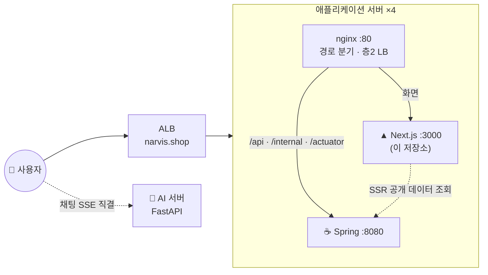

# 🛍️ NARVIS — 에이전틱 커머스 프론트엔드

> 대화로 상품을 찾고, 장바구니에 담고, 구매까지 할 수 있는 **에이전틱 커머스(Agentic Commerce)** 서비스의 웹 클라이언트입니다.
> 사용자가 보는 모든 화면과 함께, AI가 대신 수행한 작업을 실시간 스트림으로 받아 화면에 반영하는 부분을 담당합니다.

<p>
  
  
  
  
  
  
  
</p>

**🔗 데모: https://narvis-shop.vercel.app** — 팀 프로젝트의 운영 서버는 종료돼, 지금은 프론트엔드만 Vercel에 배포해 목 데이터로 동작합니다. 게스트 상태로 홈·상품·채팅 화면을 볼 수 있고, 로그인이 필요한 기능은 사용할 수 없습니다. 자세한 범위는 [실행 방법](#-실행-방법--기술-문서)의 목 모드 설명을 참고해 주세요.

---

## 📌 프로젝트 소개 & 담당 범위

서비스는 세 개의 저장소로 나뉘어 있고, 이 저장소는 사용자가 직접 보고 조작하는 화면 전체를 맡고 있습니다.

| 저장소 | 담당 |
|---|---|
| **프론트엔드 (이 저장소)** | 구매자·판매자 화면 26개 페이지, 채팅 UI, SSE 스트림 처리, 인증 흐름, 앱 티어 nginx |
| 백엔드 | 인증·권한, 상품·장바구니·주문 등 커머스 원본 데이터 |
| AI 서버 | 대화형 추천·장바구니 에이전트, 판매자 분석 챗봇, 개인화 프로필 |

**팀 프로젝트(부트캠프 최종 프로젝트)** 에서는 프론트엔드를 혼자 담당했습니다. 화면 설계와 구현, 백엔드·AI 서버와 맞춘 API 계약 반영을 맡았습니다.

**프로젝트가 끝난 뒤에는 개인 작업으로** 이 저장소의 기술 문서를 포트폴리오용으로 정리하고, 채팅 기능의 테스트를 보강했습니다. 단위 테스트의 결함 탐지력을 검증하고(T1), 실제 브라우저 E2E로 결함을 찾아 고친 뒤(T2), 그 E2E를 CI에서 자동으로 실행하도록 연결했습니다(T3).

---

## 🧰 핵심 기능 & 기술 스택

- 💬 **대화형 쇼핑** — 자연어로 상품을 찾고, 조건 칩을 눌러 필터를 빼거나 완화할 수 있습니다. 검색이 진행되는 단계도 화면에 표시합니다
- 🛒 **비로그인 쇼핑** — 게스트도 장바구니 담기까지 할 수 있고, 로그인하면 담아 둔 상품이 그대로 이어집니다
- 🔐 **쿠키 기반 인증** — 새로고침해도 로그인이 복원되고, 토큰이 만료되면 자동으로 재발급합니다. 구매자·판매자 역할별로 접근을 제한합니다
- 🗂️ **탭 단위 대화 관리** — 대화는 탭마다 따로 보관하고, 서버 세션은 여러 탭이 함께 씁니다
- 📊 **판매자 챗봇** — 매출·통계 질문에는 분석 리포트로 답하고, 상품 수정은 AI가 만든 초안을 판매자가 확인한 뒤 적용합니다(HITL)
- 🧠 **취향 프로필** — AI가 파악한 취향을 방사형 그래프로 보여 줍니다
- 📱 **모바일 우선 반응형** — 360px 화면부터 데스크톱까지 같은 코드로 대응합니다

| 영역 | 기술 | 선택 이유 |
|---|---|---|
| 프레임워크 | **Next.js 16 (App Router)** | 검색 노출이 필요한 공개 페이지(홈·상품 상세·브랜드)만 SSR하고, 로그인이 필요한 화면은 클라이언트에서 렌더링합니다 |
| 서버 상태 | **React Query 5** | 서버 데이터는 React Query로 관리하고, 데이터가 바뀌면 관련 쿼리를 무효화해 최신 상태를 반영합니다 |
| 클라이언트 상태 | **Zustand** | 인증 정보, 현재 대화, UI 상태처럼 서버에 없는 상태만 둡니다 |
| 폼 · HTTP | **React Hook Form + Zod · axios** | 폼 검증 규칙을 백엔드 필드 정의와 맞추고, 토큰 재발급 처리는 axios 인터셉터 한 곳에 모았습니다 |
| 스타일 | **Tailwind v4 + shadcn/ui** | 색상·모서리·간격을 디자인 토큰으로 고정해, 혼자 개발해도 화면마다 스타일이 달라지지 않게 했습니다 |
| 테스트 | **Vitest · Playwright** | 로직과 훅은 Vitest(jsdom)로 빠르게 확인하고, 연결 끊김·새로고침·멀티탭처럼 브라우저에서만 재현되는 동작은 Playwright(Chromium)로 확인합니다 |

---

## 💡 주요 기술적 문제 해결

### 1. AI가 바꾼 장바구니를 화면에 반영하기 — React Query

AI 에이전트는 대화 중에 장바구니나 찜 목록을 직접 바꿉니다. 이 변경은 서버에서 일어나기 때문에, 그대로 두면 화면의 캐시는 이를 알지 못하고 헤더의 장바구니 배지도 바뀌지 않습니다.

그래서 AI의 변경도 사용자가 직접 바꾼 경우와 같은 방식으로 처리했습니다. SSE로 `action` 이벤트가 오면 `isCartMutatingAction` 같은 판정 함수로 종류를 구분하고, `['cart']`·`['wishlist']` 쿼리를 무효화합니다. 같은 상품이 두 번 담기지 않도록 실패한 액션은 자동으로 재시도하지 않습니다.

추천 상품 카드도 같은 원칙을 따릅니다. 스트림에는 상품 식별자만 싣고 가격·이미지는 백엔드에서 따로 조회하며, 조회한 데이터는 상세 페이지 캐시에 미리 넣어 카드를 눌렀을 때 다시 요청하지 않습니다.

"새 대화"로 이전 응답을 버린 경우에도 서버에서 이미 끝난 장바구니·찜 변경은 캐시에 반영해야 하며, 이 규칙은 `chatEventHandler.test.ts`로 고정했습니다.

→ [architecture/data.md §4](docs/architecture/data.md) · [architecture/chat.md §4·§6](docs/architecture/chat.md)

### 2. 쿠키 기반 인증과 401 재발급

Access Token과 Refresh Token을 httpOnly 쿠키로 옮긴 뒤로는 JavaScript가 토큰을 읽을 수 없습니다. 보안에는 유리하지만, 프론트엔드가 "지금 로그인한 상태인가"를 직접 판단할 방법도 함께 사라졌습니다.

그래서 "세션 복원이 끝났고 사용자 정보가 있다"는 조건(`selectIsAuthReady`)을 인증 준비 신호로 정하고, 로그인이 필요한 쿼리는 이 신호가 켜진 뒤에만 실행합니다. 복원 전에 요청을 보내면 만료된 토큰으로 401을 받고 재발급 요청이 한꺼번에 몰리기 때문입니다.

401은 상태 코드가 아니라 응답 본문의 code로 구분합니다.

- `AUTH_TOKEN_EXPIRED` — 토큰 만료. 한 번 재발급한 뒤 원래 요청을 다시 보냅니다
- `AUTH_REQUIRED` — 재발급할 수 없음. 바로 로그인 화면으로 안내합니다

여러 요청이 동시에 401을 받아도 재발급은 single-flight로 묶어 한 번만 일어납니다. 행동 로그 수집처럼 사용자가 시작하지 않은 요청은 이 경로를 쓰지 않습니다. 배경 요청 하나 때문에 사용자가 로그인 화면으로 이동하는 일을 막기 위해서입니다.

`refresh.test.ts`(동시 호출 시 재발급 1회, 실패 뒤 재시도 가능)와 `analytics/retry.test.ts`(16건, 재전송 대상은 401 하나이고 한 번뿐)로 확인합니다.

→ [architecture/auth.md](docs/architecture/auth.md) · [troubleshooting/analytics-401-retry.md](docs/troubleshooting/analytics-401-retry.md)

### 3. SSR 초기 데이터와 캐시가 어긋난 문제

2026년 7월, 브랜드 페이지에서 정렬을 바꿔도 목록이 바뀌지 않는 문제가 있었습니다. 오류 메시지도 로딩 표시도 없이 이전 목록이 그대로 남아 있었습니다.

원인은 서버에서 렌더링한 결과를 모든 쿼리 키의 `initialData`로 넘긴 데 있었습니다. 정렬을 바꿔 새 쿼리 키가 생겨도 이전 정렬의 데이터가 초기값으로 들어갔고, `staleTime`이 30분이라 React Query는 이 데이터를 최신으로 보고 다시 조회하지 않았습니다.

서버가 렌더링에 쓴 조건(`serverQuery`)을 함께 넘기고, 현재 조건과 같을 때만 `initialData`를 쓰도록 바꿨습니다. 비교 전에 기본값을 채워서 `undefined`와 `"popular"`처럼 같은 뜻의 값을 다르게 판단하지 않게 했습니다. 이 경로를 확인하는 자동 회귀 테스트는 아직 없습니다.

→ [architecture/data.md §3](docs/architecture/data.md)

### 4. 스트리밍이 중단된 답변 구분하기

AI 답변이 스트리밍되는 도중에 다른 화면으로 갔다가 돌아오면, 중간에 끊긴 답변이 완료된 답변처럼 표시되는 문제가 있었습니다.

화면을 떠날 때 스트림을 중단(abort)하는 것은 의도된 동작이라 오류로 기록하지 않습니다. 그런데 메시지에 완료 여부를 나타내는 상태가 없어서, 오류가 없는 답변은 모두 완료된 것으로 보였습니다. 화면을 떠난 뒤에는 저장 구독도 해제돼 중단 사실이 저장되지 않았습니다.

답변마다 `streaming`, `complete`, `failed`, `interrupted` 중 하나의 상태를 두었습니다. 저장된 대화를 복원할 때 아직 `streaming`인 답변은 끊긴 것이므로 `interrupted`로 바꿉니다. 중단 시점에 저장이 안 됐더라도 복원 시점에 판단할 수 있고, 사용자는 답변 아래의 "응답이 중단됐어요" 안내로 끊긴 답변을 구분할 수 있습니다.

이 문제는 Chromium E2E 테스트에서 발견했습니다. 수정 전 10회 모두 실패, 수정 후 10회 모두 통과했고, 복원 시 상태를 바꾸는 처리만 끄면 4회 모두 다시 실패해 이 처리가 실제 원인을 해결했음을 확인했습니다.

→ [architecture/chat.md §8](docs/architecture/chat.md) · [T2-C3 기록](docs/ai-development/2026-11-09-browser-e2e/c3-navigate-away-mid-stream.md) · [stream-lifecycle-bugs.md](docs/troubleshooting/stream-lifecycle-bugs.md)

### 5. 누른 즉시 반응하는 화면 — 낙관적 업데이트

찜 하트나 조건 칩처럼 자주 누르는 요소가 서버 응답을 기다리면, 누른 뒤에도 화면이 그대로라 안 눌린 것처럼 보입니다. 그래서 화면을 먼저 바꾸고 서버 결과로 맞추는 방식을 썼습니다.

찜은 React Query의 `onMutate`에서 진행 중인 조회를 먼저 취소(`cancelQueries`)하고 목록 캐시를 바꿉니다. 취소하지 않으면 늦게 도착한 조회 결과가 방금 바꾼 화면을 덮어쓰기 때문입니다. 실패하면 이전 목록으로 되돌리고, 끝나면 다시 조회해 서버 값과 맞춥니다. 찜 목록을 한 번도 불러오지 않은 화면에서도 하트가 바로 반응하도록 진행 중인 요청 상태를 따로 둡니다.

캐시를 바꾸는 규칙은 순수 함수로 분리해 `wishlistOptimistic.test.ts`(15건)로 고정했습니다. 연타 시 중복 삽입, 캐시가 없을 때의 처리, 캐시 불변성, 이미 원하는 상태(409)일 때 오류 문구를 띄우지 않는지를 확인합니다. 실패 시 되돌리는 동작 자체는 별도 테스트가 없습니다.

채팅의 조건 칩도 X를 누르면 화면에서 먼저 지우고, 다음 응답의 조건 목록으로 덮어써 어긋난 상태가 남지 않게 했습니다.

→ [architecture/data.md §4](docs/architecture/data.md) · [architecture/chat.md §7](docs/architecture/chat.md)

### 6. 직접 구현한 화면 컴포넌트

필요한 기능에 비해 라이브러리가 큰 경우에는 직접 구현했습니다. dialog·select 같은 범용 부품은 shadcn/ui를 가져와 디자인 토큰에 맞춰 씁니다.

- **취향 방사형 그래프** — 노드 구조가 고정돼 있어 d3-force 같은 물리 시뮬레이션이 필요하지 않았습니다. SVG로 직접 그리고, 좌표 계산은 렌더링과 분리된 순수 함수로 두어 각도 배분과 라벨 겹침 방지를 `graphLayout.test.ts`(18건)로 확인합니다
- **모바일 채팅 바텀시트** — 좁은 화면에서는 대화와 상품 결과가 같은 공간을 나눠 써야 해서, 대화를 아래에서 끌어올리는 시트로 만들었습니다. Pointer Events로 드래그를 처리하고, 이동 거리나 속도가 기준을 넘으면 펼침·접힘 중 한쪽으로 붙습니다. 접힌 시트가 상품 목록 마지막 줄을 가리지 않도록 시트 높이만큼의 여백을 CSS 변수로 전달합니다. 키보드로는 토글 버튼만 조작할 수 있고, 드래그 성능은 측정하지 않았습니다
- **채팅 마크다운** — AI 응답은 신뢰할 수 없는 입력이라, HTML을 걸러내는 대신 처음부터 해석하지 않는 자체 파서를 만들었습니다. 스트리밍 중 아직 닫히지 않은 강조 표시도 처리하며, `markdown.test.ts`(25건)로 확인합니다

→ [features/ui-implementation-notes.md](docs/features/ui-implementation-notes.md)

### 그 밖의 설계 결정

**탭 단위 대화 보관** — 서버는 대화 맥락을 마지막 요청 후 10분만 유지합니다. 화면에 대화를 그보다 오래 남기면, 대화는 보이는데 AI는 기억하지 못하는 상황이 길어집니다. 그래서 대화 내용과 대화 식별자(`threadId`)는 `sessionStorage`에 탭 단위로 저장하고, 서버 세션과 접속 티켓은 `localStorage` 캐시에 두어 여러 탭이 함께 씁니다.

여러 탭이 동시에 세션을 발급하지 않도록 Web Locks로 요청 순서를 조정합니다. 락을 얻은 뒤 캐시를 한 번 더 확인해, 기다리는 동안 다른 탭이 발급한 세션이 있으면 그대로 씁니다. 세션이 갱신되면 `BroadcastChannel`로 다른 탭에 알립니다. 판단 로직은 `sessionCoordinator.test.ts`로 고정했고, 새 탭 2개(opener 없음)에서 동시에 스트리밍해도 대화와 저장소가 섞이지 않는지는 E2E(T2-A1)로 확인했습니다. → [chat.md §3·§8](docs/architecture/chat.md)

**URL 쿼리와 SSR** — `useSearchParams`를 쓰는 컴포넌트는 Suspense 경계로 감싸야 하는데, 그 경계 안쪽은 SSR 결과가 빈 HTML이 됩니다. 페이지 전체를 감쌌다가 로그인 화면이 9KB짜리 빈 껍데기로 나간 적이 있어서, 지금은 쿼리 값이 렌더링에 꼭 필요한 경우에만 경계를 좁게 두고, 클릭 같은 이벤트 시점에만 필요하면 그때 직접 읽습니다.

### 성능 측정

성능은 코드를 읽고 짐작하기보다 직접 측정해서 판단했고, 가설이 틀린 경우도 기록했습니다. 아래 수치는 모두 로컬 측정이며 실제 사용자 환경의 성능을 측정한 것은 아닙니다.

| 대상 | 측정 결과 | 측정 조건 |
|---|---|---|
| CSR → SSR 전환 | LCP 단축 — 상품 상세 4.18초 → 2.41초(42%), 브랜드 4.04초 → 2.70초(33%), 홈 3.34초 → 2.30초(31%). SEO 점수 83 → 100. 대신 JS는 190KB → 473KB로 늘었습니다 | Lighthouse 모바일, 실측 스로틀링 3회 중앙값, 목 데이터 |
| 상품 상세 이미지 | 접힌 상세 이미지가 `loading="lazy"`에도 전부 내려받아지고 있어, 접힌 동안 렌더링하지 않게 바꿨습니다. 7개 상품 추가 측정에서 초기 전송량 감소율 중앙값은 8%입니다. 94MB GIF가 있던 한 상품에서는 142.9MB → 216KB로 줄었지만 이는 극단적인 사례입니다 | 대표 상품은 DevTools 실측(캐시 비활성화). 7개 상품은 렌더링 대상 이미지의 실제 크기를 합산해 계산 |
| 기각한 가설 | 웹폰트 서브셋은 전송량을 66% 줄였지만 LCP가 오히려 늦어져 적용하지 않았습니다. 홈 히어로 애니메이션은 CPU 4배 감속에서도 60fps를 유지해 코드를 바꾸지 않았습니다 | 각 문서에 측정 과정과 정정 이력 기록 |

→ [ssr-measurement.md](docs/performance/ssr-measurement.md) · [image-loading.md](docs/performance/image-loading.md) · [hero-animation.md](docs/performance/hero-animation.md)

---

## 🤖 AI 활용 개발 및 검증 — T1 → T2 → T3

프로젝트가 끝난 뒤 Claude Code로 채팅 기능의 테스트를 설계·구현·실행했습니다. AI가 테스트 작성, 실행, 원인 분석을 맡았고, 검증 기준과 결함 판단, 수정 범위는 제가 결정했습니다.

| 단계 | 확인한 것 | AI가 한 일 | 제가 판단한 일 | 결과 |
|---|---|---|---|---|
| **T1** 단위 테스트 | 제품 코드에 일부러 결함을 넣었을 때 테스트가 실패하는지(변이 검증) | `useChat` 테스트 25건과 변이 15개 작성, 결함 재현과 수정안 구현 | 테스트 개수가 아니라 탐지력을 기준으로 삼고, 재현된 결함의 수정 범위를 승인 | 통과하지만 결함을 잡지 못하던 테스트 1건을 찾아 보완. Vitest 330 → 509건 |
| **T2** 브라우저 E2E | jsdom에서 재현할 수 없는 연결 끊김·새로고침·멀티탭을 Chromium에서 재현 | Playwright 환경과 시나리오 구현, 원인 분석, 결함 주입 | 회귀 테스트와 관찰 테스트를 구분하고, 결함 분류와 수정안을 승인 | 사례 4의 결함을 발견해 수정. 기대 동작이 정해지지 않은 동작은 결함으로 단정하지 않고 관찰로 남김 |
| **T3** CI | 로컬에서만 돌던 E2E를 PR마다 자동 실행 | GitHub Actions `e2e` 잡 구성, Node 20 로컬 검증 | 기존 잡·테스트 설정을 바꾸지 않도록 범위 제한 | `check`·`e2e` 잡 2회 연속 성공 |

**현재 테스트 구성** (2026-11-10 측정)

| 구분 | 규모 | 내용 |
|---|---|---|
| Vitest + jsdom | 40개 파일, 526건 | SSE 파서, 이벤트 처리, 세션 조정, `useChat` 턴 처리, 판매자 채팅 화면 |
| Playwright + Chromium | 15건 (회귀 10, 관찰 5) | 프로덕션 빌드에 테스트 백엔드와 SSE 서버를 붙여 실행. 관찰 테스트는 현재 동작을 정답으로 단언하지 않음 |
| GitHub Actions | `check`, `e2e` | PR마다 병렬 실행. `check`는 ESLint·Vitest·빌드, 재시도 없음 |

**검증 한계** — E2E는 실제 백엔드·AI 서버 대신 테스트 서버를 쓰고, nginx와 standalone 실행을 거치지 않으며, Chromium에서만 확인했습니다. 서버의 멱등성(같은 요청이 두 번 와도 한 번만 처리되는지)은 검증하지 않았습니다. CI는 두 번 실행한 결과만 확인했고 잡 로그 본문은 보지 못해, 장기 안정성은 아직 알 수 없습니다.

시나리오별 결과, 결함 주입 수치, 관찰 사례(C2c·D1a), 작업 중 정정한 내용은 [docs/ai-development/](docs/ai-development/README.md)에, 단위 테스트 범위는 [testing/contract-tests.md](docs/testing/contract-tests.md)에 정리했습니다.

---

## 🏗️ 시스템 아키텍처 & 프로젝트 구조

### 팀 프로젝트 운영 구조 (현재 종료)

아래는 팀 프로젝트 기간에 `narvis.shop`으로 운영했던 구조입니다. 지금은 이 서버들이 내려가 있습니다.



- 프론트 컨테이너 안에서 nginx와 Next가 함께 실행됐습니다. Next는 `127.0.0.1:3000`에만 바인딩하고, 외부에 열린 포트는 nginx의 80번 하나였습니다
- 브라우저는 API를 화면과 같은 오리진의 `/api`로 호출하고, nginx가 이를 백엔드로 전달했습니다. 교차 출처 요청이 아니므로 백엔드에 CORS·credentials 허용 설정을 따로 맞추지 않아도 인증 쿠키가 요청에 실립니다. 로컬에는 nginx가 없어 `src/app/api/[...path]/route.ts`가 같은 역할을 하고, http 환경에서도 쿠키가 저장되도록 개발 모드에서만 쿠키의 `Secure` 속성을 떼고 `SameSite`를 `Lax`로 바꿉니다
- 채팅 스트림은 예외였습니다. 브라우저가 세션 발급 응답으로 받은 AI 서버 주소에 직접 `fetch`로 연결하므로 이 요청은 교차 출처이고, AI 서버가 이 앱의 오리진에 CORS를 열어 줘야 했습니다. POST 본문을 실어야 해서 `EventSource`는 쓰지 않습니다

### 현재 데모 (Vercel)

지금의 데모에는 nginx·Spring·AI 서버가 없고, Vercel에 배포된 Next 앱 하나가 `MOCK_API=1`로 실행됩니다. 클라이언트 코드는 운영 때와 같고, 응답을 만드는 쪽만 목으로 바뀝니다.

- 브라우저의 `/api` 요청은 운영 때와 같은 경로로 나가고, `src/app/api/[...path]/route.ts`가 `src/mocks/`의 목 응답을 돌려줍니다
- SSR 페이지(홈·상품 상세·브랜드)는 서버 전용 API 모듈이 같은 목 데이터를 읽어 렌더링합니다
- 채팅은 세션 발급 목이 AI 서버 주소 대신 같은 오리진의 `/api/mock-chat/stream`을 내려주고, 이 라우트가 미리 짜 둔 SSE 프레임을 시간 간격을 두고 재생합니다
- 목이 처리하지 않는 요청(주문·배송지 등)은 백엔드로 전달하려다 실패해 오류를 반환합니다

### 프로젝트 구조

```
src/
├── app/                      # 라우트 — 화면 구현 없이 features를 조합 (api/[...path]: 로컬 전용 프록시)
├── features/<page>/          # 페이지별 화면 구현 (components · hooks · utils)
└── shared/
    ├── chat/                 # 챗봇 공통 모듈 — 스트림 파싱, 세션, 조건 칩, 액션 반영
    ├── api/ auth/            # axios 클라이언트(인증 처리), 서버 전용 클라이언트, 가드, 세션 복원
    ├── stores/ hooks/ types/ # 클라이언트 상태, 공용 훅, API 계약 타입
    ├── analytics/            # 행동 로그 수집 (사용자 흐름과 분리된 배경 전송)
    └── ui/                   # 도메인을 모르는 순수 UI 컴포넌트
e2e/                          # Playwright 시나리오, 테스트 백엔드, SSE 서버
docs/                         # 구조·계약·사건 기록 (docs/README.md가 색인)
```

한 페이지에서만 쓰는 코드는 페이지 폴더에 두고, 두 곳 이상에서 쓰기 시작할 때만 `shared`로 옮깁니다. 상품 추천과 판매자 분석, 두 챗봇은 같은 채팅 API를 채널만 바꿔 사용하고, 채널마다 다른 렌더러를 주입합니다.

---

## 🚀 실행 방법 & 기술 문서

Node.js 20 이상이 필요합니다. 실제 백엔드가 없어도 목 데이터로 화면을 확인할 수 있습니다.

```bash
npm ci
cp .env.example .env.local   # 환경변수 채우기

MOCK_API=1 npm run dev       # 백엔드 없이 목 데이터로 실행 (http://localhost:3000)
npm run dev                  # 로컬 백엔드(localhost:8080)에 연결해 실행 — 개발 서버는 3000번 포트

npm run build                # 타입 검사를 포함하므로 최종 확인은 빌드로 합니다
npm run lint
npm run test                 # Vitest(jsdom)
npm run test:e2e             # Playwright — 빌드 후 next start, 테스트 서버를 직접 띄움
                             # (처음 한 번 npx playwright install chromium)
```

목 모드는 화면 확인용이라 지원 범위가 제한됩니다.

- 홈·상품 상세·브랜드 화면과 장바구니 조회, 채팅을 확인할 수 있습니다. 채팅은 실제 AI가 아니라, 입력한 문장의 키워드에 따라 미리 짜 둔 응답(상품 추천, 조건 칩 제거, 장바구니 담기, 검색 결과 없음)을 스트리밍합니다
- 로그인 상태는 게스트로 고정됩니다. 로그인·회원가입, 마이페이지, 주문·결제, 찜 추가, 판매자 화면은 목 모드에서 사용할 수 없습니다
- 장바구니 변경은 성공으로 응답하지만 저장되지 않아, 장바구니는 항상 같은 목록을 보여 줍니다
- 목이 처리하지 않는 요청은 `API_PROXY_TARGET`의 백엔드로 전달되므로, 백엔드가 없으면 해당 요청은 실패합니다

환경변수 설명은 [.env.example](.env.example)에 있습니다. `NEXT_PUBLIC_API_BASE_URL`은 빌드할 때 번들에 포함되므로 이미지 빌드 시점에 넣어야 합니다.

| 그룹 | 경로 | 내용 |
|---|---|---|
| 랜딩 · 홈 | `/` · `/home` | 서비스 소개(이전 주소 `/landing`은 `/`로 영구 리다이렉트), 추천·인기 상품(SSR) |
| 탐색 | `/products/[id]` · `/brands/[id]` | 상품 상세(옵션·후기), 브랜드 홈 — SSR |
| 채팅 · 구매 | `/chat` · `/cart` · `/checkout` | 대화형 상품 탐색, 장바구니(게스트 가능), 주문·모의 결제 |
| 마이페이지 · 판매자 | `/mypage/**` · `/seller/**` | 주문·배송지·후기·찜·취향 프로필 / 대시보드·상품 관리·분석 챗봇 |
| 인증 · 운영 | `/login` · `/signup` · `/healthz` | 로그인(이전 페이지로 복귀), 회원가입, 헬스 체크 |

**CI** — PR을 올리면 GitHub Actions의 `check`와 `e2e` 잡이 실행됩니다. 이 잡들은 검사만 하고 배포하지 않습니다.

**배포** — 지금의 데모는 Vercel이 이 저장소와 연결돼 배포합니다. 팀 프로젝트 기간에는 `기능 브랜치 → dev → main` 순서로 병합했고, `main`에 병합되면 `deploy.yml` 워크플로가 이미지를 빌드해 운영 서버 4대에 2대씩 무중단 배포하고, 기동에 실패하면 직전 이미지로 자동 롤백했습니다. 이 워크플로는 당시 운영용 설정으로 남아 있으며 이 저장소에서는 실행된 기록이 없습니다. 절차는 [deploy-handoff.md](docs/migration/deploy-handoff.md)에 있습니다.

API 계약이나 구조가 바뀌면 [CLAUDE.md](CLAUDE.md)도 함께 수정합니다([드리프트 이력](docs/ai-development/claude-md-drift.md)).

| 문서 | 내용 |
|---|---|
| [docs/README.md](docs/README.md) | 전체 문서 색인 |
| [architecture/chat.md](docs/architecture/chat.md) · [auth.md](docs/architecture/auth.md) · [data.md](docs/architecture/data.md) | 채팅(통신 경로, SSE 이벤트 11종, 세션과 멀티탭), 인증(세션 복원, 401 처리, 가드), 데이터(쿼리 키, 무효화, SSR 경계) |
| [features/ui-implementation-notes.md](docs/features/ui-implementation-notes.md) · [features/page-spec.md](docs/features/page-spec.md) | 직접 구현한 UI 컴포넌트, 화면별 명세 |
| [performance/](docs/performance/ssr-measurement.md) | SSR·이미지·애니메이션 성능 측정 기록 |
| [testing/contract-tests.md](docs/testing/contract-tests.md) | 테스트 전략, 영역별 범위와 한계 |
| [troubleshooting/stream-lifecycle-bugs.md](docs/troubleshooting/stream-lifecycle-bugs.md) | 스트림 결함과, 그 수정이 일으킨 회귀를 처리한 과정 |
| [ai-development/](docs/ai-development/README.md) | AI 활용 개발 기록 (T1 · T2 · T3) |
